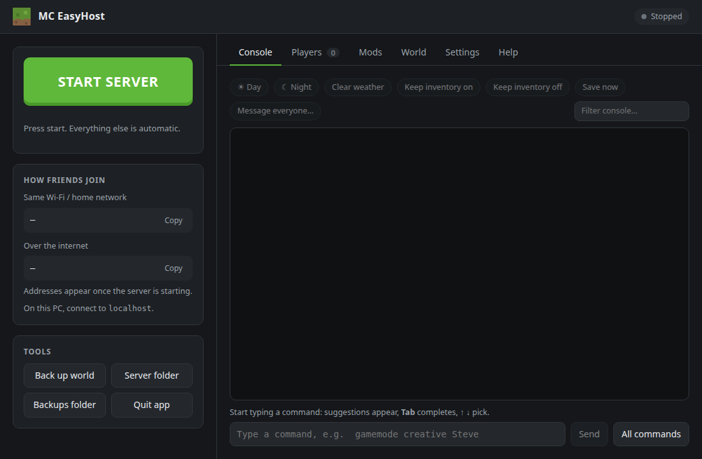

# MC EasyHost

One-click Minecraft Java server for **Windows** and **Linux**. Start the app and press **Start Server**.



*Unofficial tool, not affiliated with Mojang or Microsoft.*

## Download

Grab the file for your system from the [Releases](../../releases) page:

| System | File |
| --- | --- |
| Windows 10/11 | `MC-EasyHost.exe`: just double-click it |
| Linux (x86-64) | `mc-easyhost-linux-x86_64.tar.gz` |
| Linux (ARM64, e.g. Raspberry Pi 4/5) | `mc-easyhost-linux-aarch64.tar.gz` |

**Windows says "Windows protected your PC"?** The exe isn't code-signed (that costs money), so SmartScreen warns
about every new download. Click **More info**, then **Run anyway**. You only have to do this once.

### Linux install

1. Download `mc-easyhost-linux-x86_64.tar.gz` from the [Releases](../../releases) page. The file lands in
   `~/Downloads`.
2. Open a terminal and run:

   ```bash
   cd ~/Downloads && tar xzf mc-easyhost-linux-x86_64.tar.gz && ./mc-easyhost-linux-x86_64/install.sh
   ```

This puts `mc-easyhost` in `~/.local/bin` and adds **MC EasyHost** to your app menu. No root is needed, and
`./mc-easyhost-linux-x86_64/install.sh --uninstall` removes it again. You can also run `./mc-easyhost` straight
from the unpacked folder without installing.

If `tar` says *Cannot open: No such file or directory*, the file isn't in the folder you're in. Check where your
browser saved it (`ls ~/Downloads`), and note that a second download may be named `…(1).tar.gz`.

**Headless servers** (no desktop): run `mc-easyhost --headless`. It keeps running until stopped and prints the
console to stdout. Open the control panel through an SSH tunnel:

```bash
ssh -L 47615:127.0.0.1:47615 your-server
```

Then browse to http://127.0.0.1:47615. To start it on boot, use the included `mc-easyhost.service`
(instructions are inside the file).

## What it does for you

- Picks the newest Minecraft version (or one you choose): **Paper** (faster, plugins), **Fabric** (mods) or **Vanilla**
- **Mods and plugins** from [Modrinth](https://modrinth.com): search, one-click install with required dependencies
  (e.g. Fabric API), remove, and "Update all" after changing the Minecraft version. Mods that players need too
  are marked. Simple Voice Chat's UDP port is opened in the firewall and on the router automatically.
- **Worlds:** start a new world from a seed (normal, large biomes, amplified, superflat), use a singleplayer world
  found in the Minecraft Launcher, Prism, Modrinth App or CurseForge, or upload one as a zip. Backups can be
  restored, and every replace backs up the current world first.
- Downloads the right **Java** version privately (Temurin from Adoptium), so nothing gets installed system-wide
- Downloads the server jar and checks its SHA checksum
- Asks once for the Minecraft EULA, then writes `eula.txt` and `server.properties`
- Picks RAM automatically (40% of the PC's memory, between 1 and 8 GB, leaving at least 3 GB for the system)
- Opens the firewall: a Windows Firewall rule (one UAC prompt), or on Linux ufw/firewalld when one is active
  (one password prompt). It also opens the port on the router via **UPnP**, explaining what to change when the
  router refuses.
- Shows the LAN and internet addresses to share, and warns when the provider uses CGNAT
- **Play from anywhere:** one switch gives the server a public address (like `name.joinmc.link`) through a free
  [playit.gg](https://playit.gg) tunnel. It works behind CGNAT, on school or dorm networks and with routers
  that don't do UPnP. You link a playit account once in the browser; the app downloads the official playit agent
  (pinned version, checksum-verified), creates the tunnels through playit's API and runs the agent only while
  the server runs. "Disconnect" deletes the tunnels again.
- **Bedrock crossplay:** "Let Bedrock players join" installs Geyser and Floodgate (Paper or Fabric), so friends on
  phones, tablets, consoles and Windows Bedrock can join without a Java account. UDP 19132 is opened in the
  firewall, on the router and (with play from anywhere) through a Bedrock tunnel.
- **Modpacks:** search Modrinth's Fabric modpacks or upload a `.mrpack`. The app sets the exact Minecraft version
  and Fabric loader the pack needs, downloads its server-side files with checksum checks (only from the hosts
  the format allows), copies its config overrides, and moves your previous mods aside. The world and your
  settings are never overwritten by a pack.
- **Updates:** when a new release is out, an "Update available" button appears. The app downloads it, checks the
  SHA-256 GitHub publishes, swaps itself and restarts; a running server is saved and started again.
- **Command helper:** the console suggests commands as you type, with a plain explanation of each, and **Tab**
  completes them: online player names, items, effects, mobs, structures and game rules (new snake_case
  names from 26.1, old ones before). "All commands" is a searchable reference, and one-click buttons do the
  common things (day/night, weather, keep inventory, save, message everyone). The console can be filtered.
- **Players:** game mode, admin, kick and ban per player, plus admin, whitelist and ban lists. While the server is
  off these are edited in the files directly (with the real Mojang account ID), so you can set them up first.
- **Safety:** automatic backups while the server runs (every 6 hours by default, newest 5 kept) and an automatic
  restart after a crash (at most 3 times in 15 minutes).
- Live console, command input, world backups (zip). The player count
  comes from the server itself (the same status ping the Minecraft server list uses), so it is always right.
- Refuses to start a world on an older version than it was last played on, since that would corrupt it
- Closing the window saves the world and stops the server, and Java never outlives the app. On Windows a job
  object handles this; on Linux the parent-death signal does.

| | Windows | Linux |
| --- | --- | --- |
| Data (world, backups, Java) | `%APPDATA%\MC EasyHost` | `~/.local/share/mc-easyhost` |
| App window | Edge in app mode | Chrome/Chromium/Edge/Brave in app mode, else default browser |
| Firewall | Windows Firewall | ufw or firewalld, if switched on |

## How it works

A single Go binary with no runtime dependencies. It serves the UI from `web/` on `127.0.0.1:47615` and opens it
in a chromeless browser window (`--app`). The local API only accepts requests with the right `Host` header and an
`X-EasyHost` header, so websites open in your browser can't control the server.

| File | Purpose |
| --- | --- |
| `main.go` | Startup, flags, single instance, HTTP API, window lifecycle |
| `server.go` | Start pipeline, Java process, console parsing, stop, backups |
| `versions.go` | Mojang version manifest + PaperMC Fill v3 API |
| `java.go` | Downloads Temurin JRE matching the version's required Java |
| `network.go` | LAN/public IP, UPnP port mapping and router error hints |
| `slp.go` | Minecraft status ping for the live player count |
| `mods.go` | Modrinth search/install/remove, dependency resolution, voice chat port |
| `modpacks.go` | Modrinth modpacks (`.mrpack`): search, install, upload |
| `crossplay.go` | Geyser + Floodgate for Bedrock players, Bedrock port |
| `tunnel.go` | Play from anywhere: playit.gg account link, tunnels, agent process |
| `update.go` | Update check against GitHub releases, self-replace and restart |
| `playerlists.go` | Admins, whitelist and bans; Mojang/offline account IDs |
| `web/commands.js` | Command reference and autocomplete |
| `worlds.go`, `nbt.go` | Seeds, singleplayer import, zip upload, backups; level.dat reader |
| `platform_windows.go` | Job object, hidden console, Edge window, Windows Firewall, RAM |
| `platform_other.go` | Linux/macOS: data folder, browser window, RAM |
| `firewall_linux.go` | ufw / firewalld via pkexec |
| `web/index.html` | The whole UI |
| `packaging/` | Icon, Linux desktop entry, installer, systemd unit |
| `scripts/package.sh` | Builds all release files into `dist/` |

## Build

```bash
./scripts/package.sh   # dist/MC-EasyHost.exe + Linux x86_64/aarch64 tarballs
```

Tests (the online test downloads Java and a server jar and checks the JVM flags):

```bash
go test ./...
EASYHOST_ONLINE=1 go test -run Online -v ./...
```

For development: `EASYHOST_NO_WINDOW=1 EASYHOST_DATA=/tmp/eh EASYHOST_PORT=47699 go run .`, then open
http://127.0.0.1:47699. The separate port lets it run next to an installed copy. `EASYHOST_RELEASES_URL` points
the updater at a local fake release JSON for testing (dev builds, version `dev`, never check for updates).

Pushing a tag like `v1.2.0` makes GitHub Actions build every package and attach them to a release.

## License

MIT. Minecraft is a trademark of Mojang/Microsoft; this project is not affiliated with them. Running a server
requires agreeing to the [Minecraft EULA](https://aka.ms/MinecraftEULA).
